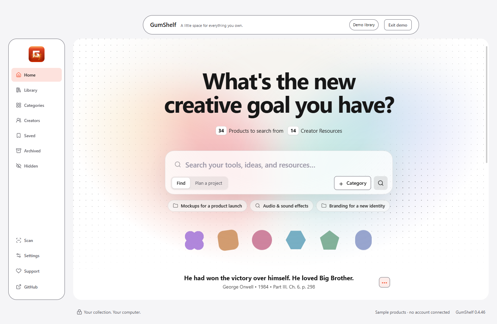
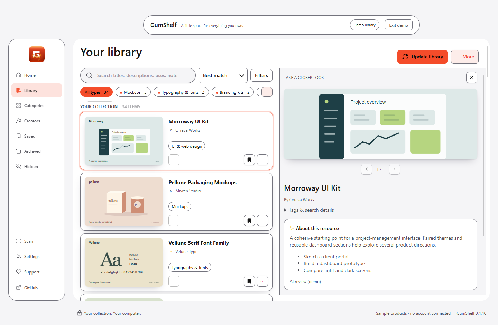
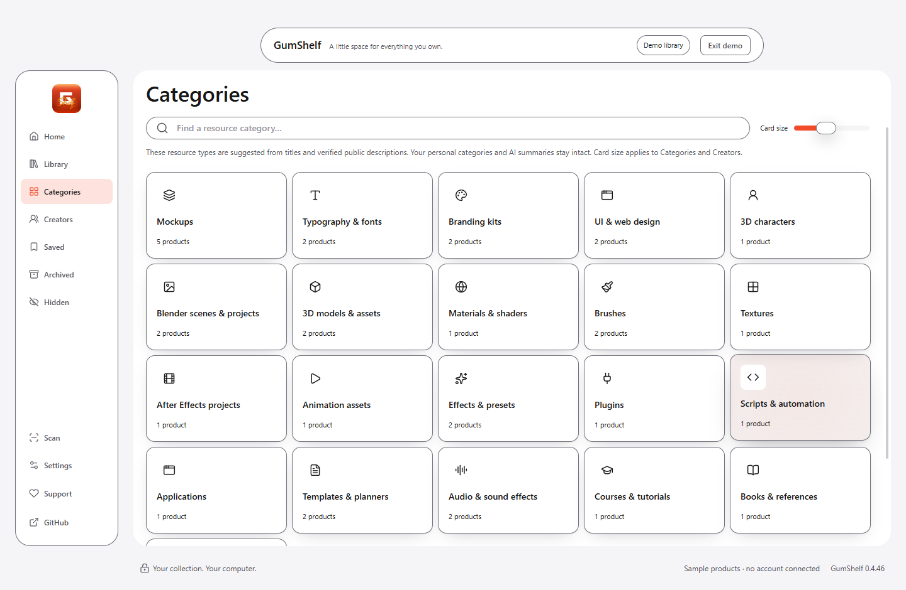
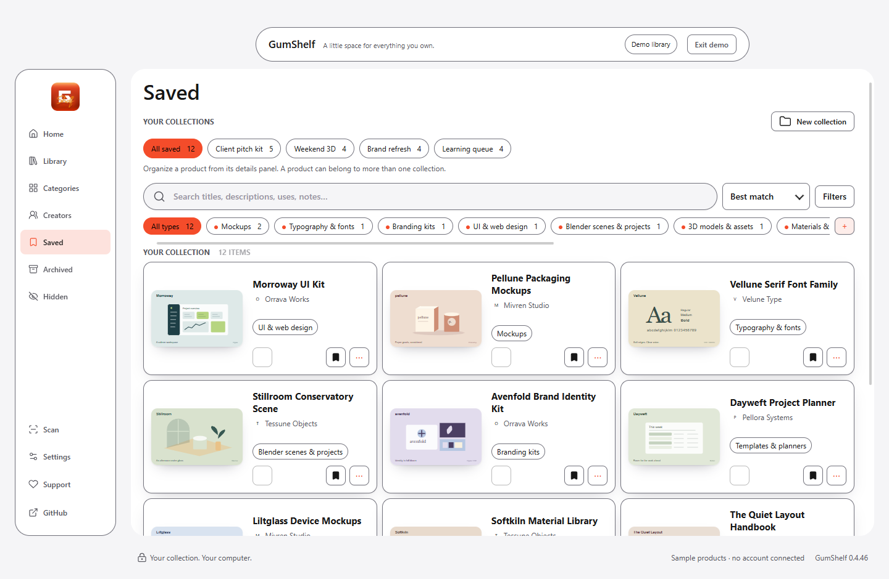
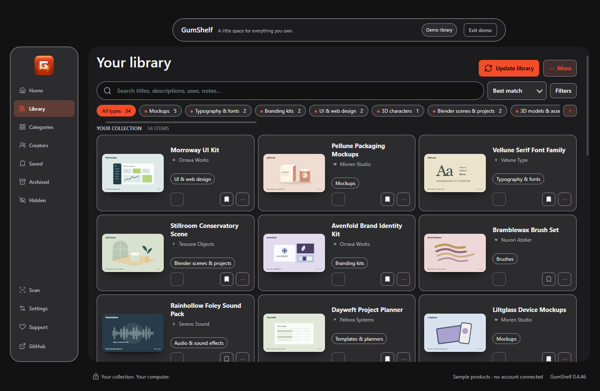

# GumShelf

A local-first Windows library for things you bought or claimed on Gumroad. GumShelf is independent and not affiliated with Gumroad.

**[Download free on Gumroad](https://osmmaankhan.gumroad.com/l/gumshelf)** · pay what you want · Windows 10/11

## Screenshots

Shown with the built-in fictional demo library.

- Search-first Home.

  

- Library search and filters.

  

- Category browsing.

  

- Creators and collections.

  

- Light, Dark and Black.

  


## Features

Search from Home using names, descriptions and project-related words. Browse categories and creators, save items into collections, and manage hidden and archived products. Optional AI Review is manual: preview an export, choose whether to send it to an AI service yourself, and review the response before applying it. Choose a Glisse-style glass interface in Light, Dark, Black or system appearance.

## Install

1. Download from https://osmmaankhan.gumroad.com/l/gumshelf, extract the portable Windows folder somewhere writable, and open GumShelf.exe. Keep the folder together.
2. Sign in to Gumroad in your usual Chrome or Edge profile and open your Gumroad Library. In GumShelf open **Connect Gumroad**.
3. Open the browser Extensions page, enable Developer mode, choose **Load unpacked**, and select the included resources/browser-helper folder. Open the helper, select your signed-in Library tab, and enter the eight-digit code shown in GumShelf.
4. Start a scan in GumShelf and keep your browser signed in while it runs.

The helper reads selected fields from your library list and public storefronts and sends them to the app over a connection on your PC. It may open a purchase/download page to locate its public storefront link; it does not extract purchase or receipt text or license keys. The library list includes product IDs and download links. The helper does not download purchased files. Gumroad page changes can interrupt scanning. See [Privacy](PRIVACY.md).

## Data and backups

By default, GumShelf Data is beside the executable; set GUMSHELF_DATA before launching to select another folder. Close GumShelf and copy the whole data folder to a safe place for a backup; restore it while the app is closed. The app also keeps library backups there. Treat this folder as private and exclude it from public releases.

## Build from source

Install Node.js and npm, then run in the project folder:

```sh
npm install
npm start
npm test
npm run package
```

Packaging writes a Windows directory build under ../../work/build. The build configuration expects an external workbook; check its availability and redistribution rights before packaging or release. Review other bundled assets and licences too.

## Roadmap

Possible future work: a Chrome Web Store helper, a signed installer, more stores, and local AI project search. Current project-related text search is distinct from future local AI search.

## Support and contribute

GumShelf is free and open source. If it helps you, an optional contribution at https://osmmaankhan.gumroad.com/l/gumshelf supports future work. Report issues or contribute at https://github.com/osmmaankhan/gumshelf; see [Contributing](CONTRIBUTING.md).

## Credits

Glisse by Kelvin Zhang is MIT licensed: [licence](app/vendor/glisse/LICENSE). Lucide icons are ISC licensed, with MIT terms for Feather-derived icons: [licence](app/vendor/lucide/LICENSE) and [notice](app/vendor/lucide/NOTICE.md). Other bundled components retain their own notices.
